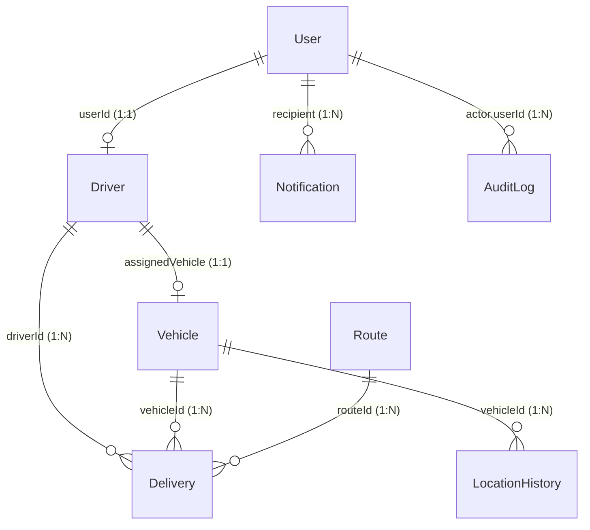

# Section 3.1: MongoDB Database Design & Schema Specification

**Project Title:** Real-Time Logistics and Fleet Tracking Portal (`FleetPulse`)  
**Academic Document Reference:** Final Degree Project Technical Report — Section 3.1: Data Tier Architecture  
**Database Engine:** MongoDB (v6.x / v7.x / v8.x) with Mongoose ODM (v8.x)

---

## 1. Overview and Entity-Relationship Architecture

The FleetPulse persistence tier utilizes a document-oriented MongoDB database designed for high-throughput telematics, geospatial proximity queries, stateful delivery tracking, and auditable user access. The architecture consists of **8 core collections**:

1. `users`: Identity, authentication credentials, role-based access control (RBAC), and account status.
2. `drivers`: Professional driver credentials, licensing metadata, active shift availability, and driver-vehicle pairings.
3. `vehicles`: Fleet assets, physical capacities, telemetry states, and instantaneous GeoJSON coordinates.
4. `routes`: Pre-planned transit corridors, origins, destinations, ordered waypoints, and GeoJSON LineString trajectories.
5. `deliveries`: Freight consignments, tracking identifiers, pickup/drop-off waypoints, priority levels, and timestamp progression.
6. `locationhistories`: Time-series GPS breadcrumb records for historical route tracing, fuel consumption, and speed analysis.
7. `notifications`: Operational alerts (geofence breaches, overspeeding incidents, delays, maintenance triggers).
8. `auditlogs`: Immutable audit trails recording system-wide administrative actions, dispatches, and state transitions.

### Entity-Relationship Diagram



---

## 2. Collections and Field Specifications

### 2.1 Collection: `users`
Manages portal operators, dispatchers, drivers, and fleet managers.

| Field Name | BSON / Mongoose Type | Required | Constraints & Validation | Default Value | Description |
| :--- | :--- | :--- | :--- | :--- | :--- |
| `_id` | `ObjectId` | Yes | Auto-generated 12-byte identifier | Auto | Primary Key |
| `name` | `String` | Yes | Trimmed, min: 2, max: 100 characters | None | Full legal or display name |
| `email` | `String` | Yes | Unique, lowercase, trimmed, RFC 5322 RegEx | None | Login email & primary contact |
| `passwordHash` | `String` | Yes | Min: 8 characters, bcrypt-hashed string | None | Salted password hash (hidden in toJSON) |
| `role` | `String` | Yes | Enum: `['admin', 'dispatcher', 'driver', 'manager', 'viewer']` | `'dispatcher'` | Role-Based Access Control level |
| `status` | `String` | Yes | Enum: `['active', 'inactive', 'suspended', 'pending']` | `'active'` | Account operational state |
| `phoneNumber` | `String` | No | Trimmed, phone regex `^\+?[0-9\s-]{7,20}$` | None | Emergency / SMS contact |
| `lastLogin` | `Date` | No | Valid ISO Date | `null` | Timestamp of latest session creation |
| `createdAt` | `Date` | Auto | Managed by Mongoose `timestamps: true` | Current UTC | Record creation timestamp |
| `updatedAt` | `Date` | Auto | Managed by Mongoose `timestamps: true` | Current UTC | Last update timestamp |

**Indexes:**
- `email`: Single-field unique index `{ email: 1 }`
- Compound Index: `{ role: 1, status: 1 }` for administrative user filtering.

---

### 2.2 Collection: `drivers`
Maintains commercial driving qualifications, contact profiles, and real-time operational availability.

| Field Name | BSON / Mongoose Type | Required | Constraints & Validation | Default Value | Description |
| :--- | :--- | :--- | :--- | :--- | :--- |
| `_id` | `ObjectId` | Yes | Auto-generated 12-byte identifier | Auto | Primary Key |
| `userId` | `ObjectId` | Yes | Refers to `User._id`, unique constraint | None | Foreign Key linking to credentials |
| `fullName` | `String` | Yes | Trimmed, min: 2, max: 100 characters | None | Certified driver name |
| `contactNumber` | `String` | Yes | Trimmed, phone regex `^\+?[0-9\s-]{7,20}$` | None | Primary mobile phone |
| `licenseNumber` | `String` | Yes | Unique, uppercase, trimmed, min: 5, max: 30 | None | Commercial Driver's License (CDL) code |
| `licenseExpiry` | `Date` | Yes | Valid Date | None | Expiration date of commercial license |
| `availability` | `String` | Yes | Enum: `['available', 'on_trip', 'off_duty', 'suspended']` | `'available'` | Dispatch status |
| `assignedVehicle` | `ObjectId` | No | Refers to `Vehicle._id`, indexed | `null` | Currently paired fleet vehicle |
| `experienceYears` | `Number` | No | Min: 0 | `1` | Verified commercial driving experience |
| `safetyRating` | `Number` | No | Min: 1.0, Max: 5.0 | `5.0` | Driver safety score based on telematics |
| `emergencyContact` | `Subdocument` | No | `{ name: String, phone: String, relationship: String }` | `{}` | Driver emergency contact record |
| `createdAt` / `updatedAt` | `Date` | Auto | `timestamps: true` | Current UTC | Audit timestamps |

**Indexes:**
- `licenseNumber`: Single-field unique index `{ licenseNumber: 1 }`
- `userId`: Single-field unique index `{ userId: 1 }`
- Compound Index: `{ availability: 1, assignedVehicle: 1 }` for automated dispatch queries.

---

### 2.3 Collection: `vehicles`
Stores fleet vehicle specifications, cargo payload limits, and live GPS coordinates.

| Field Name | BSON / Mongoose Type | Required | Constraints & Validation | Default Value | Description |
| :--- | :--- | :--- | :--- | :--- | :--- |
| `_id` | `ObjectId` | Yes | Auto-generated 12-byte identifier | Auto | Primary Key |
| `vehicleNumber` | `String` | Yes | Unique, uppercase, trimmed, min: 3, max: 20 | None | License plate or fleet asset code |
| `makeModel` | `String` | No | Trimmed string | `'Commercial Carrier'` | Manufacturer and chassis model |
| `type` | `String` | Yes | Enum: `['semi_truck', 'box_truck', 'cargo_van', 'flatbed', 'refrigerated_truck', 'light_truck']` | None | Vehicle physical classification |
| `capacity.weightKg` | `Number` | Yes | Min: 0 kg | None | Maximum allowable cargo weight |
| `capacity.volumeM3` | `Number` | No | Min: 0 cubic meters | `0` | Usable cargo compartment volume |
| `status` | `String` | Yes | Enum: `['active', 'in_transit', 'idle', 'maintenance', 'decommissioned']` | `'idle'` | Real-time vehicle operating state |
| `assignedDriver` | `ObjectId` | No | Refers to `Driver._id`, indexed | `null` | Currently assigned driver |
| `lastLocation` | `GeoJSON Point` | Yes | `{ type: 'Point', coordinates: [lng, lat], speed, heading, updatedAt }` | None | Instantaneous geospatial position |
| `fuelCapacityLiters` | `Number` | No | Min: 0 | `200` | Fuel tank capacity in liters |
| `currentFuelPercent` | `Number` | No | Min: 0, Max: 100 | `100` | Estimated remaining fuel % |
| `odometerKm` | `Number` | No | Min: 0 | `0` | Cumulative mileage reading |
| `createdAt` / `updatedAt` | `Date` | Auto | `timestamps: true` | Current UTC | Audit timestamps |

**Indexes:**
- `vehicleNumber`: Single-field unique index `{ vehicleNumber: 1 }`
- `lastLocation`: **GeoJSON 2dsphere index** `{ lastLocation: '2dsphere' }` for `$near` proximity searches.
- Compound Index: `{ status: 1, type: 1 }` for fleet inventory querying.

---

### 2.4 Collection: `routes`
Defines standard logistics routes, intermediate waypoints, and polyline geometries.

| Field Name | BSON / Mongoose Type | Required | Constraints & Validation | Default Value | Description |
| :--- | :--- | :--- | :--- | :--- | :--- |
| `_id` | `ObjectId` | Yes | Auto-generated 12-byte identifier | Auto | Primary Key |
| `name` | `String` | Yes | Trimmed, min: 3, max: 150 characters | None | Human-readable route name |
| `code` | `String` | No | Unique, uppercase, trimmed, sparse | None | Standard route identifier code |
| `origin` | `Subdocument` | Yes | `{ name, address, location: GeoJSON Point }` | None | Departure terminal / logistics hub |
| `destination` | `Subdocument` | Yes | `{ name, address, location: GeoJSON Point }` | None | Arrival warehouse / fulfillment hub |
| `waypoints` | `Array of Subdocs`| No | Ordered array of `{ sequence, name, location, estimatedStopMinutes }` | `[]` | Mandatory intermediate stops |
| `routeGeometry` | `GeoJSON LineString`| Yes | Coordinates: Array of at least two `[lng, lat]` pairs | None | Full polyline path of highway route |
| `distance.valueKm` | `Number` | Yes | Min: 0 | None | Total route distance in km |
| `distance.estimatedDurationMinutes` | `Number` | Yes | Min: 0 | None | Nominal transit time in minutes |
| `isActive` | `Boolean` | No | Boolean flag | `true` | Route availability toggle |
| `createdAt` / `updatedAt` | `Date` | Auto | `timestamps: true` | Current UTC | Audit timestamps |

**Indexes:**
- `routeGeometry`: **GeoJSON 2dsphere index** `{ routeGeometry: '2dsphere' }`
- `origin.location`: **GeoJSON 2dsphere index** `{ 'origin.location': '2dsphere' }`
- `destination.location`: **GeoJSON 2dsphere index** `{ 'destination.location': '2dsphere' }`
- `name`: Single-field index `{ name: 1 }`

---

### 2.5 Collection: `deliveries`
Tracks the lifecycle of freight shipments from initial dispatch to proof-of-delivery.

| Field Name | BSON / Mongoose Type | Required | Constraints & Validation | Default Value | Description |
| :--- | :--- | :--- | :--- | :--- | :--- |
| `_id` | `ObjectId` | Yes | Auto-generated 12-byte identifier | Auto | Primary Key |
| `trackingCode` | `String` | Yes | Unique, uppercase, trimmed, min: 6, max: 30 | None | Public tracking reference |
| `pickup` | `Subdocument` | Yes | `{ address, contactName, contactPhone, location: GeoJSON Point, scheduledTime }` | None | Consignor address and coordinate |
| `destination` | `Subdocument` | Yes | `{ address, recipientName, recipientPhone, location: GeoJSON Point, scheduledTime }` | None | Consignee address and coordinate |
| `vehicleId` | `ObjectId` | No | Refers to `Vehicle._id`, indexed | `null` | Transport vehicle assignment |
| `driverId` | `ObjectId` | No | Refers to `Driver._id`, indexed | `null` | Assigned freight driver |
| `routeId` | `ObjectId` | No | Refers to `Route._id`, indexed | `null` | Assigned pre-planned route |
| `status` | `String` | Yes | Enum: `['pending', 'assigned', 'picked_up', 'in_transit', 'out_for_delivery', 'delivered', 'failed', 'cancelled']` | `'pending'` | Consignment lifecycle status |
| `cargo.description` | `String` | Yes | Trimmed string | None | Manifest description of items |
| `cargo.weightKg` | `Number` | No | Min: 0 | `0` | Shipment weight |
| `cargo.volumeM3` | `Number` | No | Min: 0 | `0` | Shipment volume |
| `cargo.isFragile` | `Boolean` | No | Boolean flag | `false` | Fragility indicator |
| `cargo.requiresRefrigeration` | `Boolean` | No | Boolean flag | `false` | Cold-chain requirement |
| `priority` | `String` | Yes | Enum: `['low', 'standard', 'high', 'critical']` | `'standard'` | Dispatch SLA priority |
| `timestamps` | `Subdocument` | No | `{ assignedAt, pickedUpAt, deliveredAt, estimatedDeliveryAt, cancelledAt }` | `{}` | Delivery milestone milestones |
| `notes` | `String` | No | Max: 500 characters | None | Handling instructions |
| `createdAt` / `updatedAt` | `Date` | Auto | `timestamps: true` | Current UTC | Audit timestamps |

**Indexes:**
- `trackingCode`: Single-field unique index `{ trackingCode: 1 }`
- `pickup.location`: **GeoJSON 2dsphere index**
- `destination.location`: **GeoJSON 2dsphere index**
- Compound Index: `{ status: 1, priority: 1 }`
- Compound Index: `{ vehicleId: 1, status: 1 }`
- Compound Index: `{ driverId: 1, status: 1 }`

---

### 2.6 Collection: `locationhistories`
High-frequency time-series telemetry store for vehicle movements.

| Field Name | BSON / Mongoose Type | Required | Constraints & Validation | Default Value | Description |
| :--- | :--- | :--- | :--- | :--- | :--- |
| `_id` | `ObjectId` | Yes | Auto-generated 12-byte identifier | Auto | Primary Key |
| `vehicleId` | `ObjectId` | Yes | Refers to `Vehicle._id`, indexed | None | Target vehicle foreign key |
| `latitude` | `Number` | Yes | Min: -90, Max: 90 | None | WGS84 Latitude coordinate |
| `longitude` | `Number` | Yes | Min: -180, Max: 180 | None | WGS84 Longitude coordinate |
| `location` | `GeoJSON Point` | Auto | `{ type: 'Point', coordinates: [lng, lat] }` (auto-synced via hook) | Auto | Standard GeoJSON Point representation |
| `speed` | `Number` | No | Min: 0 km/h | `0` | Instantaneous vehicle ground speed |
| `heading` | `Number` | No | Min: 0, Max: 360 degrees | `0` | Compass heading (azimuth) |
| `altitude` | `Number` | No | Number in meters | `0` | Altitude above sea level |
| `source` | `String` | Yes | Enum: `['gps_transponder', 'mobile_app', 'simulated', 'manual_entry', 'obd_ii']` | `'gps_transponder'` | Telemetry acquisition source |
| `timestamp` | `Date` | Yes | Valid ISO Date, indexed | `Date.now` | Precise observation timestamp |
| `telemetry.odometerKm` | `Number` | No | Min: 0 | `null` | Current odometer reading |
| `telemetry.fuelLevelPercent`| `Number` | No | Min: 0, Max: 100 | `null` | Sensor fuel tank reading % |
| `telemetry.engineStatus` | `String` | No | Enum: `['on', 'off', 'idle', 'diagnostic_error']` | `'on'` | Engine ignition / OBD-II status |
| `telemetry.batteryVoltage` | `Number` | No | Voltage in Volts | `null` | Vehicle alternator / battery voltage |

**Indexes:**
- `location`: **GeoJSON 2dsphere index** `{ location: '2dsphere' }`
- Compound Time-Series Index: `{ vehicleId: 1, timestamp: -1 }` (optimizes historical path queries)
- Single-field Index: `{ timestamp: -1 }` for global telemetry purging and retention.

---

### 2.7 Collection: `notifications`
System and operational notifications dispatched to portal operators and managers.

| Field Name | BSON / Mongoose Type | Required | Constraints & Validation | Default Value | Description |
| :--- | :--- | :--- | :--- | :--- | :--- |
| `_id` | `ObjectId` | Yes | Auto-generated 12-byte identifier | Auto | Primary Key |
| `recipient` | `ObjectId` | Yes | Refers to `User._id`, indexed | None | Target operator / driver user |
| `category` | `String` | Yes | Enum: `['geofence_breach', 'overspeeding', 'harsh_braking', 'route_deviation', 'delivery_delayed', 'delivery_completed', 'maintenance_due', 'system']` | None | Operational category of the alert |
| `severity` | `String` | Yes | Enum: `['info', 'low', 'warning', 'critical']` | `'info'` | Alert urgency level |
| `message` | `String` | Yes | Trimmed, min: 5, max: 1000 characters | None | Descriptive message body |
| `readStatus` | `Boolean` | No | Boolean flag | `false` | Acknowledgment status |
| `metadata.vehicleId` | `ObjectId` | No | Refers to `Vehicle._id` | `null` | Optional related vehicle |
| `metadata.deliveryId` | `ObjectId` | No | Refers to `Delivery._id` | `null` | Optional related delivery |
| `metadata.driverId` | `ObjectId` | No | Refers to `Driver._id` | `null` | Optional related driver |
| `metadata.actionUrl` | `String` | No | Trimmed URL path | `null` | Direct portal deep link |
| `createdAt` | `Date` | Yes | Valid Date | `Date.now` | Alert generation timestamp |

**Indexes:**
- Compound Inbox Index: `{ recipient: 1, readStatus: 1, createdAt: -1 }`
- Compound Category Index: `{ category: 1, severity: 1 }`

---

### 2.8 Collection: `auditlogs`
Immutable compliance and security audit logs.

| Field Name | BSON / Mongoose Type | Required | Constraints & Validation | Default Value | Description |
| :--- | :--- | :--- | :--- | :--- | :--- |
| `_id` | `ObjectId` | Yes | Auto-generated 12-byte identifier | Auto | Primary Key |
| `actor.userId` | `ObjectId` | No | Refers to `User._id` | `null` | Initiating user identifier |
| `actor.name` | `String` | Yes | Trimmed string | None | Actor display name |
| `actor.role` | `String` | Yes | Trimmed string | None | Actor role at time of execution |
| `actor.ipAddress` | `String` | No | IP address string | `'127.0.0.1'` | Client source IP address |
| `action` | `String` | Yes | Enum: `['CREATE', 'UPDATE', 'DELETE', 'LOGIN', 'LOGOUT', 'STATUS_CHANGE', 'DISPATCH', 'ROUTE_ASSIGNMENT', 'EMERGENCY_OVERRIDE']` | None | Operation code |
| `entity.type` | `String` | Yes | Enum: `['User', 'Vehicle', 'Driver', 'Route', 'Delivery', 'System', 'Notification']` | None | Target entity class |
| `entity.id` | `ObjectId` | No | Target document `_id` | `null` | Target document identifier |
| `entity.identifier` | `String` | No | Trimmed string | `null` | Human-readable identifier (e.g. tracking code) |
| `changes.before` | `Mixed` | No | JSON object capturing pre-mutation state | `null` | Snapshot before mutation |
| `changes.after` | `Mixed` | No | JSON object capturing post-mutation state | `null` | Snapshot after mutation |
| `timestamp` | `Date` | Yes | Valid Date | `Date.now` | Event timestamp |

**Indexes:**
- Compound Entity Index: `{ 'entity.type': 1, 'entity.id': 1, timestamp: -1 }`
- Single-field Index: `{ timestamp: -1 }`
- Single-field Index: `{ 'actor.userId': 1 }`

---

## 3. Relationships and Integrity Rules

1. **User &rarr; Driver (1:1):** Every commercial driver must be authenticated via a corresponding `User` account. Enforced by unique index on `Driver.userId`.
2. **Vehicle &rarr; Driver (1:1 Active Pairing):** Vehicles reference an assigned `Driver` document, and Drivers reference an `assignedVehicle`. State synchronization ensures an inactive or suspended driver cannot be bound to an active vehicle.
3. **Delivery &rarr; Vehicle & Driver & Route (N:1 Relationships):** Deliveries store direct references to the servicing vehicle (`vehicleId`), driver (`driverId`), and designated route corridor (`routeId`).
4. **Vehicle &rarr; LocationHistory (1:N Time-Series):** High-frequency GPS telemetry streams append location entries indexed by `{ vehicleId: 1, timestamp: -1 }`.
5. **Cascading Safety:** When an entity status changes (e.g. a Vehicle enters `maintenance`), an `AuditLog` entry is generated and associated in-transit deliveries trigger operational notifications.

---

## 4. GeoJSON Implementation and 2dsphere Indexing

MongoDB utilizes the standard WGS84 coordinate reference system with **[longitude, latitude]** order (East-West longitude first, North-South latitude second).

- **Point Geometry:**
  ```json
  {
    "type": "Point",
    "coordinates": [-122.3957, 37.7812]
  }
  ```
- **LineString Geometry:**
  ```json
  {
    "type": "LineString",
    "coordinates": [
      [-122.4048, 37.7765],
      [-122.4216, 37.6547],
      [-122.1430, 37.4419],
      [-121.9056, 37.3712]
    ]
  }
  ```
- **Geospatial Proximity Queries:**
  The `2dsphere` indexes on `vehicles.lastLocation`, `deliveries.destination.location`, and `routes.routeGeometry` enable instant execution of spherical queries including:
  - `$near`: Locate the closest available vehicle to a delivery pickup location.
  - `$geoWithin`: Verify whether a vehicle is inside a geofenced terminal boundary.
  - `$geoIntersects`: Detect route deviation by checking if the vehicle's position intersects the route corridor buffer.

---

## 5. Sample Production JSON Documents

Below are representative JSON documents extracted from the verified seed dataset in `backend/src/seeds/sampleJson/`.

### 5.1 Vehicle Document (`vehicles.json`)
```json
{
  "_id": "65e8a3000000000000000004",
  "vehicleNumber": "FL-REF-402",
  "makeModel": "Volvo VNL 760 Reefer Unit",
  "type": "refrigerated_truck",
  "capacity": {
    "weightKg": 21000,
    "volumeM3": 88
  },
  "status": "in_transit",
  "assignedDriver": "65e8a2000000000000000003",
  "lastLocation": {
    "type": "Point",
    "coordinates": [-122.0842, 37.422],
    "speed": 74.2,
    "heading": 130,
    "updatedAt": "2026-10-15T05:15:00.000Z"
  },
  "fuelCapacityLiters": 420,
  "currentFuelPercent": 68,
  "odometerKm": 185600
}
```

### 5.2 Delivery Document (`deliveries.json`)
```json
{
  "_id": "65e8a5000000000000000001",
  "trackingCode": "DEL-2026-90412",
  "pickup": {
    "address": "BioPharma Cold Storage, South San Francisco, CA",
    "contactName": "Dr. Evelyn Reed",
    "contactPhone": "+1-555-012-3344",
    "location": {
      "type": "Point",
      "coordinates": [-122.4216, 37.6547]
    },
    "scheduledTime": "2026-10-15T03:15:00.000Z"
  },
  "destination": {
    "address": "Stanford Health Care Pavilion, Palo Alto, CA",
    "recipientName": "Pharmacy Logistics Desk",
    "recipientPhone": "+1-555-012-7788",
    "location": {
      "type": "Point",
      "coordinates": [-122.1704, 37.4348]
    },
    "scheduledTime": "2026-10-15T07:15:00.000Z"
  },
  "vehicleId": "65e8a3000000000000000004",
  "driverId": "65e8a2000000000000000003",
  "routeId": "65e8a4000000000000000001",
  "status": "in_transit",
  "cargo": {
    "description": "Temperature-Sensitive Vaccines & Biologics (-20C)",
    "weightKg": 850,
    "volumeM3": 4.5,
    "isFragile": true,
    "requiresRefrigeration": true
  },
  "priority": "critical",
  "timestamps": {
    "assignedAt": "2026-10-15T01:15:00.000Z",
    "pickedUpAt": "2026-10-15T03:15:00.000Z",
    "estimatedDeliveryAt": "2026-10-15T06:45:00.000Z"
  },
  "notes": "Maintain internal container temperature below -20 deg Celsius at all times."
}
```

### 5.3 Route Document with LineString (`routes.json`)
```json
{
  "_id": "65e8a4000000000000000001",
  "name": "San Francisco to San Jose Tech Express",
  "code": "RT-SF-SJ-01",
  "origin": {
    "name": "San Francisco Central Logistics Hub",
    "address": "450 7th St, San Francisco, CA 94103",
    "location": {
      "type": "Point",
      "coordinates": [-122.4048, 37.7765]
    }
  },
  "destination": {
    "name": "Silicon Valley South Distribution Yard",
    "address": "1850 Junction Ave, San Jose, CA 95112",
    "location": {
      "type": "Point",
      "coordinates": [-121.9056, 37.3712]
    }
  },
  "waypoints": [
    {
      "sequence": 1,
      "name": "South San Francisco Crossdock",
      "location": {
        "type": "Point",
        "coordinates": [-122.4216, 37.6547]
      },
      "estimatedStopMinutes": 20
    }
  ],
  "routeGeometry": {
    "type": "LineString",
    "coordinates": [
      [-122.4048, 37.7765],
      [-122.4216, 37.6547],
      [-122.3255, 37.5630],
      [-122.2272, 37.4852],
      [-122.1430, 37.4419],
      [-122.0842, 37.4220],
      [-121.9899, 37.3861],
      [-121.9056, 37.3712]
    ]
  },
  "distance": {
    "valueKm": 78.5,
    "estimatedDurationMinutes": 65
  },
  "isActive": true
}
```

---

## 6. Verification and Test Results Summary

Schema constraints, enum boundaries, GeoJSON coordinate limits, and reference integrity were tested using the automated test suite (`npm run test:schemas`):

```
======================================================
       PHASE 2: MONGOOSE SCHEMA VALIDATION SUITE      
======================================================

--- 1. Testing Valid Schema Instantiation & Validation ---
  [PASS] User "Marcus Vance" passes schema validation
  [PASS] User "Elena Rostova" passes schema validation
  [PASS] Driver "Alexander Morgan" passes schema validation
  [PASS] Vehicle "FL-TRK-101" (semi_truck) passes schema validation
  [PASS] Vehicle "FL-REF-402" (refrigerated_truck) passes schema validation
  [PASS] Route "San Francisco to San Jose Tech Express" passes GeoJSON LineString validation
  [PASS] Delivery "DEL-2026-90412" passes schema validation
  [PASS] LocationHistory point [37.7812, -122.3957] passes validation
  [PASS] Notification (overspeeding / warning) passes validation
  [PASS] AuditLog [DISPATCH] for entity Delivery passes validation

--- 2. Testing Constraint & Enum Rejection Assertions ---
  [PASS] Rejects invalid email format
  [PASS] Rejects invalid role enum value
  [PASS] Rejects out-of-bounds GeoJSON coordinates
  [PASS] Rejects negative vehicle capacity weight
  [PASS] Rejects invalid delivery status enum

--- 3. Testing Relationship Reference Integrity ---
  [PASS] All sample drivers have valid User ObjectId foreign keys
  [PASS] All assigned vehicle drivers map to valid Driver ObjectIds
  [PASS] All assigned deliveries map to valid Vehicle ObjectIds

--- 4. Database Connectivity Probe ---
  Probing configured MONGODB_URI: mongodb://127.0.0.1:27017/fleet_tracking
  [PASS] Application graceful offline mode verified (non-fatal)

======================================================
  TEST RESULTS: 44/44 Passed (0 Failed)
======================================================
```
